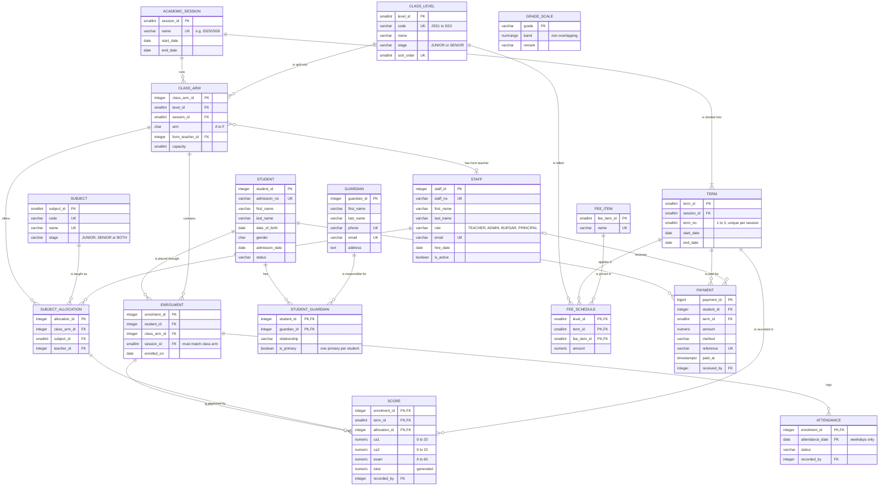

# Harmetage Private School: ER diagram

GitHub renders this diagram automatically. For the LMS document, paste the code block into https://mermaid.live and export it as PNG.

`GRADE_SCALE` has no foreign key relationships. Scores are matched to grades by range lookup (`score.total <@ grade_scale.band`), not by a stored grade, so it appears on its own.
